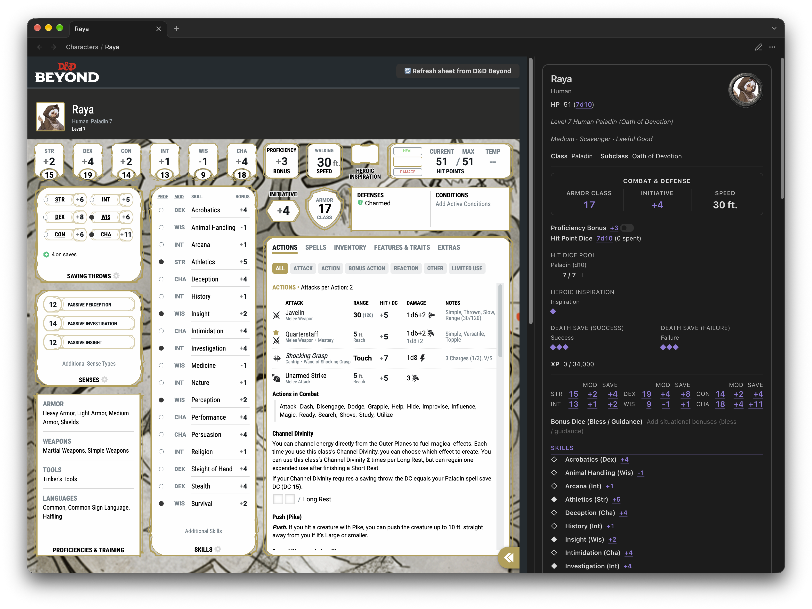
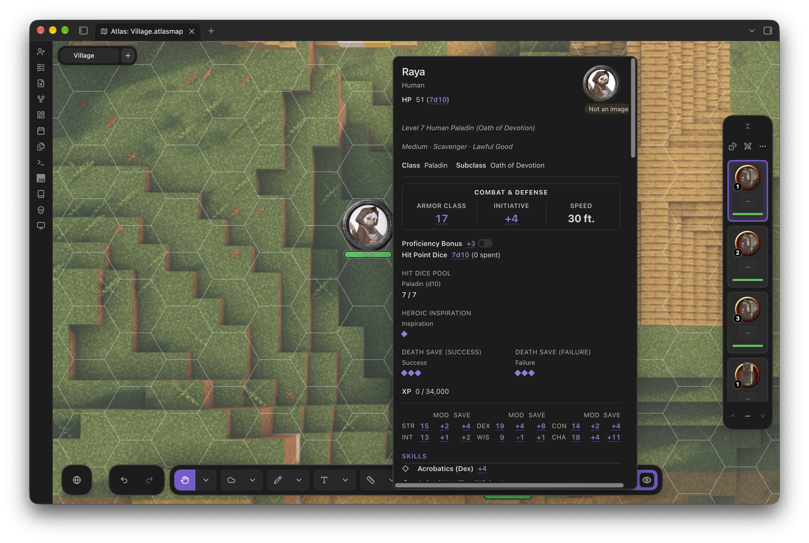

<div align="center">

# D&D Beyond Importer for Atlas VTT

### Import any public D&D Beyond character sheet into Obsidian as a ready to use statblock for Atlas VTT.

</div>

<p align="center">
  
  
</p>

---

## Installation

### Obsidian Community Plugin (recommended for stable releases)
1. Open **Settings**
2. Go to **Community plugins**
3. Click **Browse**
4. Search **"D&D Beyond Importer for Atlas"**
5. Click **Install**, then **Enable**
6. Configure plugin settings *(optional)*

### Manual
1. Download the latest release zip from the [Releases page](https://github.com/young-george/DnD-Beyond-Importer-for-Atlas/releases) (or build from source below)
2. Unzip into your vault's plugin directory:
   ```
   <YourVault>/.obsidian/plugins/dndbeyond-importer-for-atlas/
   ```
   The folder needs `main.js`, `manifest.json`, and `styles.css`
3. Go to **Obsidian → Settings → Community Plugins** and enable **D&D Beyond Importer for Atlas**

### Build from source
```bash
git clone https://github.com/young-george/DnD-Beyond-Importer-for-Atlas.git
cd dndbeyond-importer-for-atlas
npm install
npm run build
```
This produces `main.js` in the project root.

Run tests with `vitest` and accept any valid changes to the snapshots.

---

## Usage

### Importing a character

**Ribbon:** click the <svg xmlns="http://www.w3.org/2000/svg" width="14" height="14" viewBox="0 0 24 24" fill="none" stroke="currentColor" stroke-width="2" stroke-linecap="round" stroke-linejoin="round" class="lucide lucide-user-plus preview-icon"><path d="M16 21v-2a4 4 0 0 0-4-4H6a4 4 0 0 0-4 4v2"/><circle cx="9" cy="7" r="4"/><line x1="19" x2="19" y1="8" y2="14"/><line x1="22" x2="16" y1="11" y2="11"/></svg> import D&D Beyond character icon in the left sidebar.

**Command palette:** `Ctrl/Cmd + P` → *D&D Beyond Importer for Atlas: Import character from D&D Beyond*

Any of these input formats work:
- Full URL — `https://www.dndbeyond.com/characters/131905892/Gk8rBed`
- Short URL — `https://www.dndbeyond.com/characters/131905892`
- Character ID — `131905892`

> The character sheet must be set to **Public** on D&D Beyond. Private sheets can't be fetched.

### Override Statblock Template
The default character sheet statblock can be overridden by specifying 

---

## Commands

`D&D Beyond Importer for Atlas: Import character from D&D Beyond`:
Import a character sheet from D&D Beyond into Obsidian as a statblock note for Atlas VTT.

`D&D Beyond Importer for Atlas: Sync all imported characters`:
Re-sync all previously imported character sheets with D&D Beyond.

---

## Settings

| Setting | Default | Description |
|:---|:---:|:---|
| Output folder | `Characters` | Vault folder where character notes are saved (leave blank for vault root). |
| Image output folder | `~/Images/` | Where character images are saved in your vault. Defaults to `Images/` relative to the imported sheet. Prefix the folder with `~` to specify a relative path. |
| Include detailed descriptions | `true` | Include detailed descriptions of features, traits, and spells in the character note, linked in the statblock. The descriptions can be viewed by hovering over the links in the statblock. |
| Embed D&D Beyond page | `true` | Embed the D&D Beyond character sheet page in the statblock note. This allows you to view the original sheet without leaving Obsidian. Obsidian edit mode can be used to view the actual note content. |
|Automatcally sync... when Obsidian opens | `true` | Automatically re-sync all character sheets with D&D Beyond when Obsidian starts. |
| Automatically sync... when opening sheet | `true` | Automatically sync character sheet when opening & viewing the note in Obsidian. This will not sync the sheet when viewing the statblock in Atlas. |
| Don't import skill modifiers | `false` | Don't import skill modifiers when syncing character sheets, use Atlas' automatically calculated modifiers instead. This might cause Atlas' skill modifiers to differ from D&D Beyond's if you have items, feats, homebrew rules or other modifiers applied. |

---

## A note on the D&D Beyond API

The plugin fetches from an unofficial internal endpoint:
```
https://character-service.dndbeyond.com/character/v5/character/{ID}
```
This isn't officially documented or supported by D&D Beyond / Wizards of the Coast and could change or break without warning. The plugin is **read-only** — it never writes anything back to D&D Beyond.

---

## Support

If you have any issues, please open a [GitHub issue](https://github.com/young-george/DnD-Beyond-Importer-for-Atlas/issues), or post a [here](https://discord.com/channels/1551361618305224816/1563313703724515338) in the Atlas VTT Discord server. Please include the character ID so that the imported sheet can be replicated and debugged.

---

<p align="center">
Built with ❤️ for the Obsidian, D&D, and Atlas community.
<br>
</p>